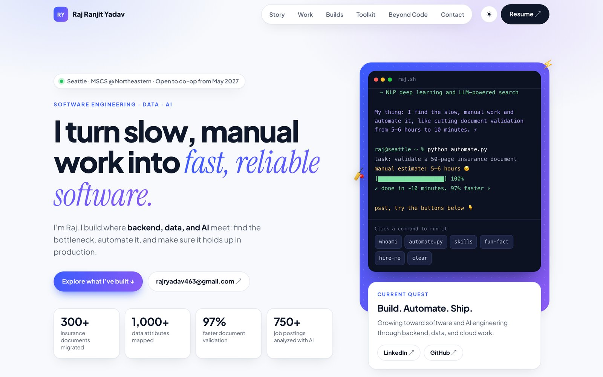
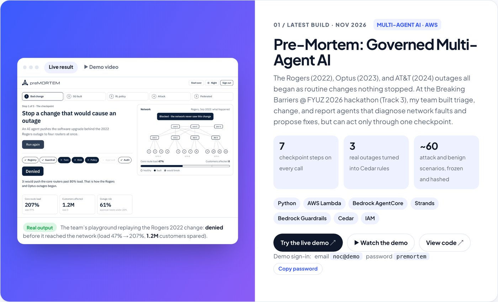
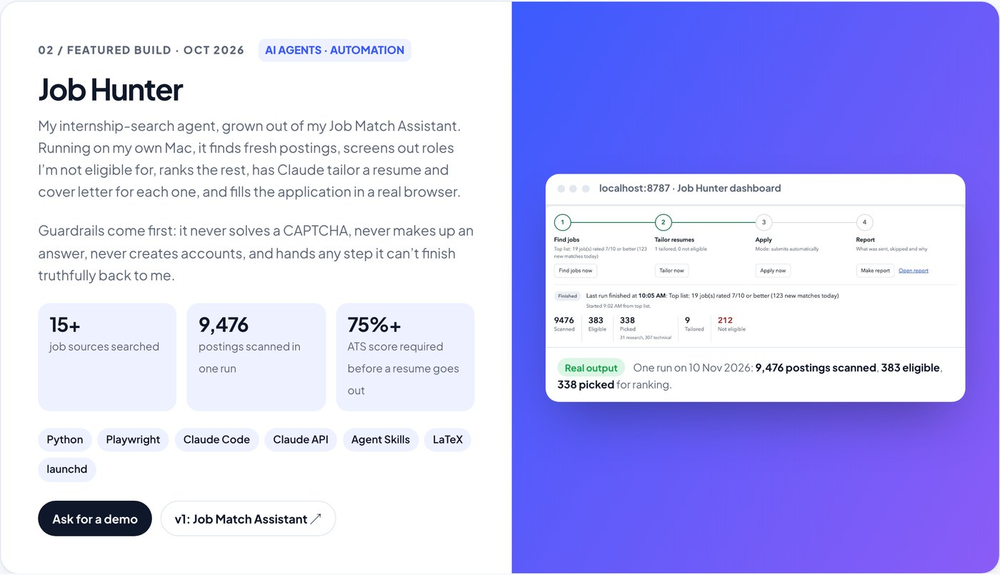
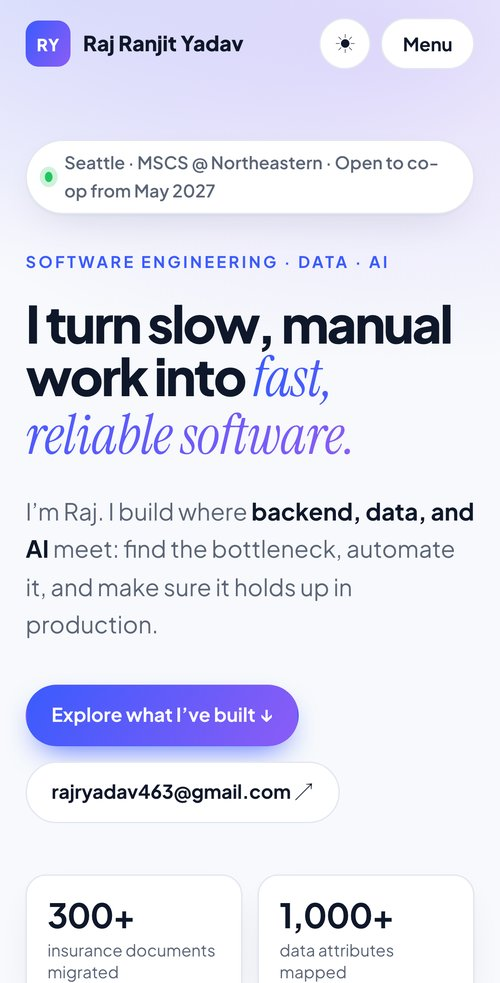

<div align="center">

# Raj Ranjit Yadav · Portfolio

**I turn slow, manual work into fast, reliable software.**

MS Computer Science @ Northeastern University, Seattle · Software engineering, data, and AI · Open to co-ops from May 2027

[](https://app.netlify.com/projects/rajranjityadav/deploys)
[](https://rajranjityadav.netlify.app)

[](https://www.linkedin.com/in/rajx463)

### [Visit the site →](https://rajranjityadav.netlify.app)

<a href="https://rajranjityadav.netlify.app">
  <picture>
    <source media="(prefers-color-scheme: dark)" srcset="docs/hero-dark.jpg">
    
  </picture>
</a>

</div>

---

## Featured builds

Every project screenshot on the site is **real output** from the project itself, not a mock-up.

### 01 · Pre-Mortem: governed multi-agent AI

<picture>
  <source media="(prefers-color-scheme: dark)" srcset="docs/premortem-card-dark.jpg">
  
</picture>

Built with my team at the **Breaking Barriers @ FYUZ 2026** hackathon (Track 3). Triage, change and report agents diagnose network faults and propose fixes, but every model, tool and agent call has to pass one 7-step checkpoint: registry, guardrails, digital twin, risk score, Cedar policy, human approval, and audit.

| | |
|---|---|
| 🕹️ **Try it** | [premortem-one.vercel.app](https://premortem-one.vercel.app/#/) · sign in with `noc@demo` / `premortem` |
| ▶️ **Watch** | [Project demo video](https://youtu.be/hvyUwNxniSE) (it also plays inline on the site) |
| 💻 **Code** | [rajryadav4/preMORTEM](https://github.com/rajryadav4/preMORTEM) |

### 02 · Job Hunter: an internship-search agent with guardrails

<picture>
  <source media="(prefers-color-scheme: dark)" srcset="docs/jobhunter-card-dark.jpg">
  
</picture>

Grown out of my [Job Match Assistant](https://github.com/rajryadav4/job-match-assistant). It runs on my own Mac. It finds fresh postings from 15+ sources, screens out roles I'm not eligible for, ranks the rest, has Claude tailor a resume and cover letter for each one, and fills the application in a real browser. It never solves a CAPTCHA, never makes up an answer, and hands any step it can't finish truthfully back to me.

### More on the site

| Project | What it is |
|---|---|
| **Toxic Comment Classifier** | A Bidirectional LSTM that scores comments across six kinds of toxicity, served in a Gradio app |
| **Smart Task Manager** | A .NET Web API and React app with JWT login and role-based access |
| **Accident Detection & Rescue** | An Android and sensor system that sends a crash's GPS location to emergency contacts. Published at ICHISS-2024 |
| **Book Recommender** | A React and .NET app serving recommendations from a relational catalog |

## What's on the page



1. **Hero:** headline, counting stats, and an interactive terminal. Click `whoami`, `automate.py`, `skills`, `fun-fact` or `hire-me` to run a command.
2. **Story (01):** why I build: find the bottleneck, automate it, like a 5–6 hour document check that became ~10 minutes.
3. **Work (02):** LTM and Jaguar Land Rover India, each with its numbers and a "How I did it".
4. **Builds (03):** the projects above.
5. **Toolkit (04):** backend and APIs, data and databases, AI and ML, cloud and delivery.
6. **Education + leadership (05):** Northeastern (MS CS, 4.0 GPA), my B.Tech, certifications, my publication, and a 3,000+ attendee expo I led.
7. **Beyond the terminal (06):** cricket captain and polyglot.
8. **Contact:** where to reach me.

<br clear="right">

## How it's built

- **One file, no build.** All the HTML, CSS and JavaScript is in `index.html`. There's no framework and no bundler.
- **Light and dark.** It follows the system theme, has a toggle, and remembers your choice.
- **Mobile-first.** Checked at 390px wide, with nothing scrolling sideways.
- **Accessible.** It respects `prefers-reduced-motion`, the media tabs work from the keyboard, and every screenshot has alt text.
- **Private by default.** The demo video uses `youtube-nocookie.com` and loads nothing from YouTube until someone presses play.
- **Fonts:** Plus Jakarta Sans, with Instrument Serif italic for the gradient accent words.

## Project layout

```text
.
├── index.html                          the whole site
├── assets/
│   ├── raj_ranjit_yadav_resume.pdf     opened by every "Resume" link
│   └── projects/                       real result screenshots on the project cards
├── docs/                               images for this README (not served on the site)
├── netlify.toml                        deploy settings: publish ".", no build step
├── CLAUDE.md                           editing rules for this repo
└── README.md
```

## Run it locally

```bash
git clone https://github.com/rajryadav4/rajranjityadav-portfolio.git
cd rajranjityadav-portfolio
python3 -m http.server 8790
```

Then open <http://localhost:8790>. You can also open `index.html` straight in a browser.

## Deploy

Every push to `main` deploys to Netlify in about a minute. The badge at the top shows the latest deploy's status. `netlify.toml` pins the settings and keeps repo-only files (`CLAUDE.md`, `README.md`, `docs/`) off the live site.

## Updating content

- **Resume:** replace `assets/raj_ranjit_yadav_resume.pdf` and keep the file name.
- **Project screenshots:** add them to `assets/projects/`. Use real output only, with no personal data.
- **Facts:** everything on the site must match the resume. [`CLAUDE.md`](CLAUDE.md) has the full rules and the list of verified numbers.

---

<div align="center">

**[rajranjityadav.netlify.app](https://rajranjityadav.netlify.app)** · [LinkedIn](https://www.linkedin.com/in/rajx463) · [GitHub](https://github.com/rajryadav4)

</div>
